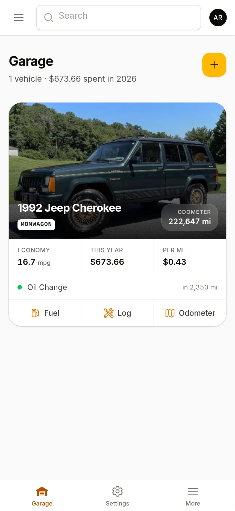
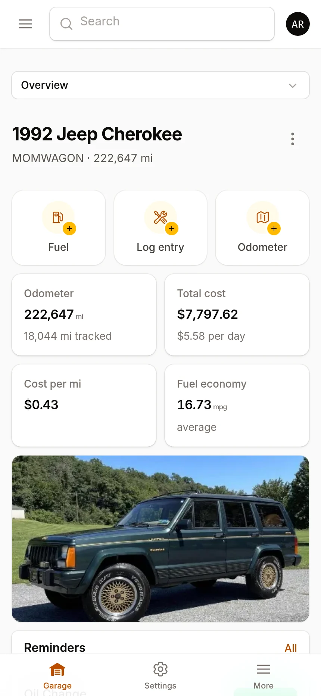
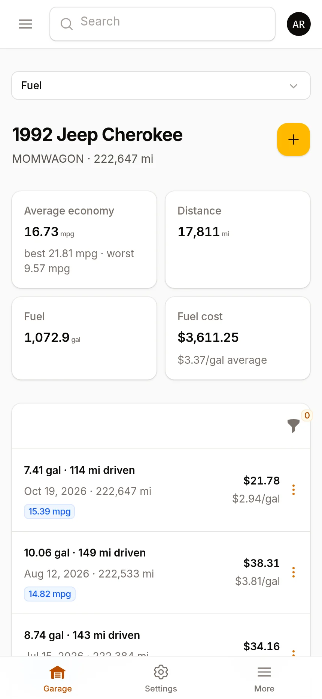
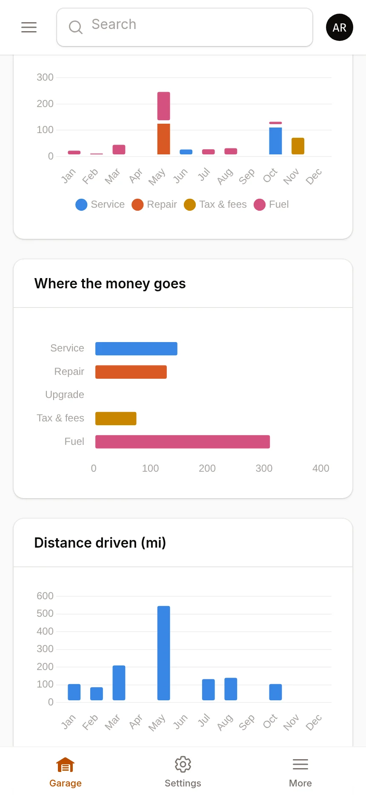
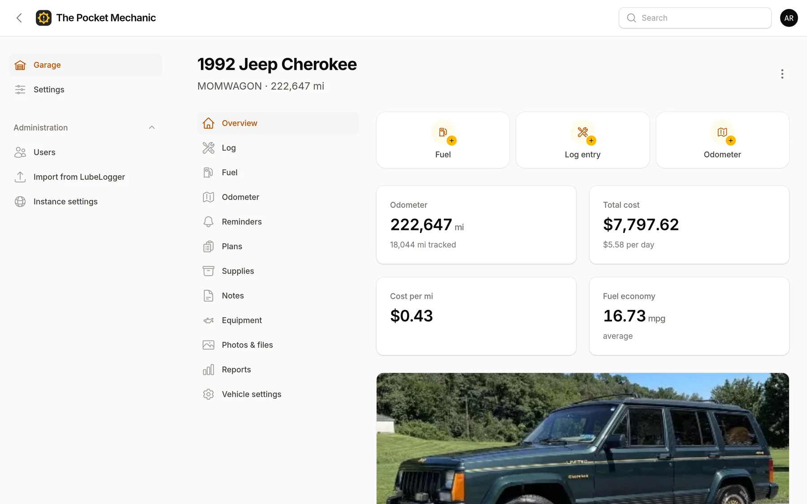
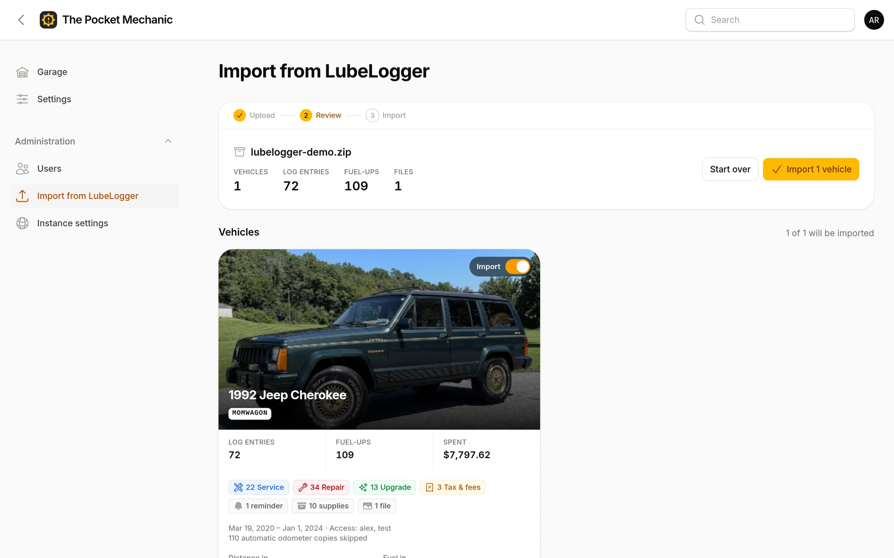

<p align="center">
  
</p>

<h1 align="center">The Pocket Mechanic</h1>

<p align="center">
  A self-hosted vehicle maintenance and fuel tracker, made for your phone.<br>
  It imports your <a href="https://github.com/hargata/lubelog">LubeLogger</a> backup, so you can bring your history along.
</p>

<p align="center">
  <a href="https://antunnitraj.github.io/tpms/">Website</a> ·
  <a href="#quick-start">Quick start</a> ·
  <a href="#importing-from-lubelogger">Import from LubeLogger</a> ·
  <a href="https://github.com/antunnitraj/tpms/releases">Releases</a>
</p>

<p align="center">
  <picture><source media="(prefers-color-scheme: dark)" srcset="docs/screenshots/garage-dark.webp"></picture>
  <picture><source media="(prefers-color-scheme: dark)" srcset="docs/screenshots/overview-dark.webp"></picture>
  <picture><source media="(prefers-color-scheme: dark)" srcset="docs/screenshots/fuel-dark.webp"></picture>
  <picture><source media="(prefers-color-scheme: dark)" srcset="docs/screenshots/reports-dark.webp"></picture>
</p>

> [!NOTE]
> The Pocket Mechanic is a separate, independent project. It is not affiliated with, endorsed by or connected to
> LubeLogger or its owner. LubeLogger is named only to describe importing its backups.

## What it does

- **Garage:** a card per vehicle with its photo, odometer, fuel economy, cost per mile or km, and the next reminder.
- **Log:** services, repairs, upgrades, and taxes and fees in one place, with attachments and tags.
- **Fuel:** fuel economy that handles partial and missed fill-ups, in L/100 km, km/L, US or UK MPG; electric cars by state of charge.
- **Odometer:** one timeline built from every entry with a mileage, plus your own readings.
- **Reminders** by date, by mileage or both. Recurring ones move on when you mark them done, and can log the work in the same step.
- **Plans** (planned, doing, done: finishing one logs it), **supplies** with stock, **equipment** such as tyre sets with distance per set, **notes**, and **photos & documents**.
- **Reports:** spending per month and per category, distance, fuel economy and price trends, and a printable history.
- **Sharing:** share a vehicle with other people on your server. Everyone it's shared with has full access.
- **Accounts:** no public sign-up; administrators create users.
- **Installable:** add it to your phone's home screen and it opens like an app.

<p align="center">
  <picture><source media="(prefers-color-scheme: dark)" srcset="docs/screenshots/desktop-overview-dark.webp"></picture>
</p>

## Quick start

You need Docker with Docker Compose.

```bash
git clone https://github.com/antunnitraj/tpms.git
cd tpms
docker compose up -d
```

Open <http://localhost:8080>. The first visit asks you to create the administrator account and pick the currency and
timezone, then offers to import a LubeLogger backup. There is nothing else to configure: the app key is generated on
first start.

> [!IMPORTANT]
> **Finish setup before exposing it.** Until the first account exists, whoever opens the page first becomes the
> administrator. The same applies after *Instance settings → Reset everything*.

To use another port, put it in a `.env` file next to `docker-compose.yml`:

```bash
echo "APP_PORT=80" > .env
```

The stack has four containers:

| Service     | What it does                                                                 |
|-------------|------------------------------------------------------------------------------|
| `app`       | The web app (nginx and PHP 8.5). Updates the database when it starts.        |
| `queue`     | Background jobs: photo and file thumbnails.                                  |
| `scheduler` | Scheduled tasks: clean-up of unfinished imports and unused thumbnails.       |
| `db`        | PostgreSQL 17.                                                               |

Data lives in two volumes: `pgdata` (the database) and `storage` (photos, documents and the generated app key).

### HTTPS and "Add to Home Screen"

Phones only install web apps served over HTTPS. Put The Pocket Mechanic behind your reverse proxy (Caddy, Traefik,
nginx, Cloudflare Tunnel, …) pointing at its port, and tell it about the proxy in the same `.env` file:

```bash
TRUSTED_PROXIES=192.168.1.10        # the proxy's IP as the app sees it (or * if only the proxy can reach the port)
SESSION_SECURE_COOKIE=true          # sign-in cookies only over HTTPS
APP_URL=https://cars.example.com
```

Then run `docker compose up -d` again. Without `TRUSTED_PROXIES` the app ignores `X-Forwarded-*` headers, so nobody can
fake their address to get around the sign-in limit, but pages behind the proxy would link to `http://`.

The proxy must:

- send `X-Forwarded-For` and `X-Forwarded-Proto` (Caddy and Traefik do; with nginx add
  `proxy_set_header X-Forwarded-Proto $scheme;` and `proxy_set_header X-Forwarded-For $proxy_add_x_forwarded_for;`);
- accept large uploads: documents up to 100 MB and LubeLogger backups up to 2 GB
  (nginx: `client_max_body_size 2g;`; Cloudflare's free plan stops at 100 MB);
- allow long requests for big imports (nginx: `proxy_read_timeout 600s;`).

Then open it on your phone and choose *Add to Home Screen* (Safari) or *Install app* (Chrome).

### Updating

Make a backup first (see below): the app updates its database by itself when it starts.

```bash
git pull
docker compose build --pull
docker compose pull db
docker compose up -d
```

`--pull` fetches security fixes for PHP and nginx. To stay on a release instead of the latest code, check out its tag,
for example `git checkout v0.1.0`.

### Backups

Back up both the database and the storage volume (photos, documents and the app key), for example nightly from cron:

```bash
docker compose exec -T db pg_dump -U tpms tpms > tpms.sql
docker run --rm -v tpms_storage:/data -v "$PWD":/backup alpine tar czf /backup/tpms-storage.tgz -C /data .
```

To restore into a fresh install, start only the database, load the dump, unpack the files, then start everything:

```bash
docker compose up -d db
docker compose exec -T db psql -U tpms tpms < tpms.sql
docker run --rm -v tpms_storage:/data -v "$PWD":/backup alpine tar xzf /backup/tpms-storage.tgz -C /data
docker compose up -d
```

> [!CAUTION]
> Never run `docker compose down -v`: `-v` deletes both volumes, which is all of your data.

## Importing from LubeLogger

<p align="center">
  <picture><source media="(prefers-color-scheme: dark)" srcset="docs/screenshots/desktop-import-dark.webp"></picture>
</p>

The Pocket Mechanic reads LubeLogger's backup format. It is a separate project, not affiliated with LubeLogger or its
owner.

1. In LubeLogger: **Settings → Backups → Make Backup** and download the ZIP.
2. In The Pocket Mechanic, as an administrator: **Administration → Import from LubeLogger** (also offered right after
   first-time setup).
3. Upload the ZIP (up to 2 GB).
4. Review the preview. It shows every vehicle (photo, counts, dates, units), every LubeLogger user and what will be
   imported. You can change the timezone LubeLogger ran in, the date format of dates stored as text, who receives the
   LubeLogger root user's vehicles, what happens to each user (create, use an existing account, or skip), and the units
   of each vehicle, or leave a vehicle out.
5. Confirm. Nothing is written before this step, and **Undo import** on the next screen removes everything it created.

From the command line:

```bash
docker compose cp backup.zip app:/tmp/backup.zip
docker compose exec app php artisan lubelogger:import /tmp/backup.zip --dry-run
```

How LubeLogger data maps:

- **Log entries:** service, repair and upgrade records and taxes become log entries. Recurring taxes also get a renewal
  reminder.
- **Inspections:** their results (✓ passed, ✗ failed) go into the notes of their log entry, so there is no duplicate
  service record.
- **Odometer:** the copies LubeLogger inserted automatically from other entries are skipped. Equipment links become
  install and remove dates.
- **Supplies:** become a stock history (an opening purchase, then each recorded use).
- **Users:** keep their LubeLogger passwords, upgraded to a secure hash on first sign-in. Households become direct
  sharing.
- **Not imported:** plan and inspection templates, shop supplies that aren't tied to a vehicle, extra field definitions
  (their values go into notes), API keys, tokens, translations, themes, kiosk and server settings.

## Development

Requirements: PHP 8.5, Composer, Node 24 or newer and PostgreSQL. The defaults expect `127.0.0.1:5432` with database,
user and password `tpms`, for example:

```bash
docker run -d -p 5432:5432 -e POSTGRES_USER=tpms -e POSTGRES_PASSWORD=tpms postgres:17-alpine
```

Then:

```bash
composer setup
php artisan dev
```

`composer setup` installs the dependencies, creates `.env`, migrates the database and builds the front end.
`php artisan dev` runs the web server, queue worker, log viewer and Vite together.

Tests use [Pest](https://pestphp.com) against a PostgreSQL database called `tpms_test`:

```bash
php artisan test
```

Built with [Laravel](https://laravel.com), [Filament](https://filamentphp.com) and
[Livewire](https://livewire.laravel.com). The screenshots show LubeLogger's demo data (MIT licensed, see
[its license](tests/Fixtures/LUBELOGGER-LICENSE.txt)) after importing it; the same file is the test fixture for the importer.

## License

[MIT](LICENSE)
